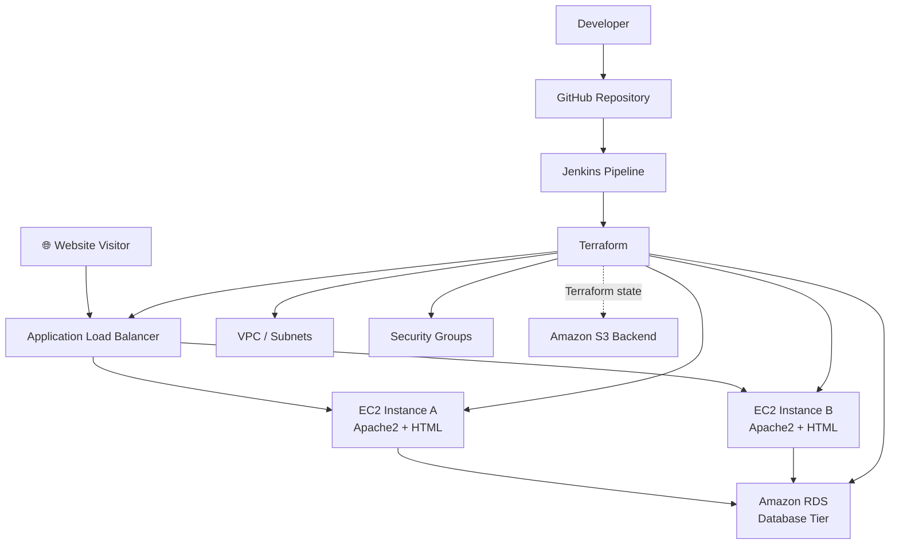
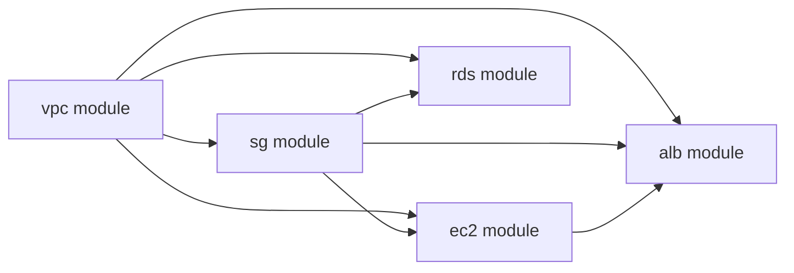
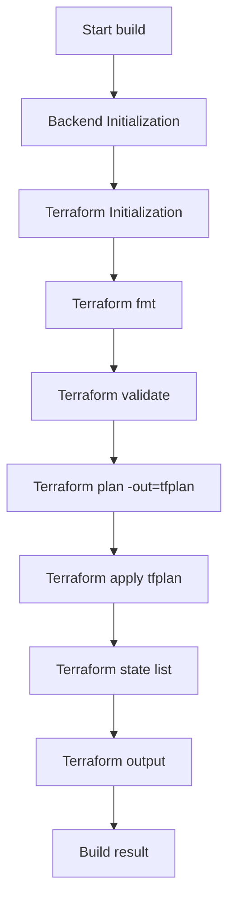

<div align="center">

# ☁️ Two-Tier AWS Web Application

### Terraform • Jenkins • EC2 • Apache2 • ALB • Amazon RDS

[](https://aws.amazon.com/)
[](https://www.terraform.io/)
[](https://www.jenkins.io/)
[](https://httpd.apache.org/)

**A hands-on AWS infrastructure project using Terraform modules to provision a website tier on EC2, an Application Load Balancer, and a managed RDS database. Jenkins automates the Terraform workflow, while Amazon S3 stores Terraform remote state.**

[Repository](https://github.com/Armaan-2005/2-tier-application) · [Architecture](#-architecture) · [Structure](#-project-structure) · [Setup](#-run-the-project)

</div>

---

## 📑 Contents

- [Project Overview](#-project-overview)
- [Architecture](#-architecture)
- [AWS Components](#-aws-components)
- [Project Structure](#-project-structure)
- [Module Relationships](#-terraform-module-relationships)
- [Jenkins Pipeline](#-jenkins-pipeline)
- [Prerequisites](#-prerequisites)
- [Run the Project](#-run-the-project)
- [Security](#-security-notes)
- [Cleanup](#-cleanup)
- [Learning Outcomes](#-learning-outcomes)

## 🎯 Project Overview

This project demonstrates a **two-tier web architecture on AWS** managed with **Terraform** and orchestrated through **Jenkins**.

The web tier uses EC2 instances running Apache2 to serve an HTML page. An **Application Load Balancer (ALB)** provides a browser-facing entry point and forwards HTTP traffic to registered EC2 targets. The data tier uses **Amazon RDS** in private subnets. Terraform state is stored in an **Amazon S3 remote backend**.

### Goals

- Provision AWS resources using Infrastructure as Code.
- Organize infrastructure into reusable Terraform modules.
- Host an HTML website using Apache2 on EC2.
- Route web traffic through an ALB target group.
- Keep the database tier separate from the web tier.
- Store Terraform state remotely in S3.
- Automate Terraform operations with a Jenkins pipeline.

## 🏗️ Architecture



<details>
<summary><strong>🔍 How the architecture works</strong></summary>

1. A visitor opens the ALB DNS address in a browser.
2. The ALB listener receives the HTTP request and forwards it to a healthy registered EC2 target.
3. Apache2 on the selected EC2 instance serves the HTML page.
4. When application functionality requires persistence, the web tier can communicate with RDS over the VPC network.
5. Terraform uses S3 to store infrastructure state separately from application traffic.
6. Jenkins runs the configured Terraform stages to provision and inspect infrastructure.

**Important:** S3 is the Terraform state backend, not the website host. The HTML page is served by Apache2 on EC2.

</details>

## ☁️ AWS Components

| Component | Role |
|---|---|
| **Amazon VPC** | Network isolation for project resources |
| **Public subnets** | Host the internet-facing ALB and, in this configuration, EC2 web instances |
| **Private subnets** | Provide subnet placement for RDS |
| **Security Groups** | Control traffic between ALB, EC2 and RDS |
| **Amazon EC2** | Runs Apache2 and serves the HTML page |
| **Apache2** | HTTP web server |
| **Application Load Balancer** | Routes incoming HTTP requests to registered targets |
| **Target Group** | Registers EC2 targets and checks their health |
| **Amazon RDS** | Managed relational database infrastructure |
| **Amazon S3** | Stores Terraform remote state |
| **Terraform** | Defines and provisions AWS infrastructure |
| **Jenkins** | Automates Terraform stages |

## 📂 Project Structure

```text
2-tier-application/
├── backend/
│   └── Terraform configuration for the S3 state backend
│
├── modules/
│   ├── vpc/
│   │   └── VPC, subnets, routing and key-pair-related resources
│   ├── sg/
│   │   └── Security groups for EC2 and RDS
│   ├── ec2/
│   │   └── EC2 instances and Apache2/HTML setup
│   ├── alb/
│   │   └── ALB, listener and target group
│   └── rds/
│       └── RDS and database subnet configuration
│
├── main.tf       # AWS provider, backend and module connections
├── output.tf     # ALB DNS URL output
├── Jenkinsfile   # Jenkins pipeline for Terraform
└── .gitignore    # Files excluded from Git
```

<details>
<summary><strong>📄 main.tf — Root Terraform configuration</strong></summary>

The root configuration declares the AWS provider and S3 backend, then connects five modules:

- `vpc` — provides the network, subnet IDs and key-pair reference.
- `sg` — receives the VPC ID and exposes security group IDs.
- `ec2` — receives subnet IDs, a security group and key-pair name; the root configuration references two EC2 target IDs.
- `alb` — receives the VPC, subnet and security-group values, along with both EC2 target IDs.
- `rds` — receives the database security group and private subnet IDs.

This keeps the high-level architecture in one place while separating individual resource definitions into modules.

</details>

<details>
<summary><strong>📁 modules/vpc — Networking</strong></summary>

Supplies the VPC and subnet resources referenced by the other modules. The root configuration uses public subnet IDs for the ALB and EC2 tier, and private subnet IDs for RDS.

</details>

<details>
<summary><strong>📁 modules/sg — Security groups</strong></summary>

Creates security groups and exports IDs consumed by EC2 and RDS. A secure configuration should allow web traffic from the ALB to EC2 and database traffic only from the intended application tier. SSH should be restricted to trusted sources.

</details>

<details>
<summary><strong>📁 modules/ec2 — Apache2 and HTML</strong></summary>

Creates the EC2 web instances using subnet, security-group and key-pair values supplied by the other modules. Apache2 serves the HTML page. The exact install and file-copy mechanism depends on the EC2 module's bootstrap configuration.

</details>

<details>
<summary><strong>📁 modules/alb — Load balancing</strong></summary>

Configures the load balancer and its target registration. The root configuration passes the two EC2 instance IDs and the public subnet IDs. The ALB DNS name is exposed as a Terraform output.

</details>

<details>
<summary><strong>📁 modules/rds — Database tier</strong></summary>

Creates the RDS resources using the database security group and private subnet IDs. The database should not be publicly accessible unless there is a specific requirement; access should be restricted to the required sources and database port.

</details>

<details>
<summary><strong>📁 backend — S3 remote state</strong></summary>

The root `main.tf` configures the S3 backend with these values:

- **Bucket:** `backend-s3-2tierapps`
- **State key:** `2-tier application/terraform.tfstate`
- **Region:** `us-east-1`

The backend bucket must exist before Terraform can initialize the root configuration against it. The Jenkins pipeline first works in `backend/`, then initializes the root configuration.

S3 stores Terraform state metadata; it does not serve the website or store the live RDS database.

</details>

<details>
<summary><strong>📄 output.tf — Website URL</strong></summary>

The `load_balancer_dns` output formats the ALB DNS name as an HTTP URL.

```bash
terraform output load_balancer_dns
```

Open the returned URL in a browser to test the load balancer and its registered targets.

</details>

## 🔗 Terraform Module Relationships



Terraform uses these module input/output references to determine dependencies and resource creation order.

## 🔄 Jenkins Pipeline

The `Jenkinsfile` defines a declarative pipeline using Windows `bat` steps and the Jenkins credential entry `AWS_credentials`.



| Stage | Purpose |
|---|---|
| Backend Initialization | Runs Terraform initialization and apply in `backend/` |
| Terraform Initialization | Initializes the root configuration and formats Terraform |
| Terraform Planning | Validates configuration and saves a plan |
| Terraform Execution | Applies the saved plan |
| Terraform State Check | Lists managed resources and prints outputs |

<details>
<summary><strong>Pipeline notes</strong></summary>

- The Jenkins agent must support Windows `bat` commands.
- Terraform must be installed and available on the agent's `PATH`.
- The `AWS_credentials` entry must exist in Jenkins.
- The backend bucket must be created before the root backend can use it.
- This pipeline automates Terraform infrastructure operations; it does not itself show a separate HTML release stage that copies changed files to EC2.

</details>

## 🧰 Prerequisites

- AWS account with permissions for the required VPC, EC2, ALB, RDS, security-group and S3 resources.
- Terraform CLI installed on the Jenkins agent.
- Jenkins with AWS credential binding support.
- A Jenkins credentials entry named `AWS_credentials`.
- Git access to this repository.
- A configured S3 backend bucket, or permission to provision it using the backend configuration.

## 🚀 Run the Project

### 1. Clone the repository

```bash
git clone https://github.com/Armaan-2005/2-tier-application.git
cd 2-tier-application
```

### 2. Configure AWS credentials

For local testing:

```bash
aws configure
aws sts get-caller-identity
```

For Jenkins, configure the credential entry referenced by the pipeline. Never hardcode access keys in Terraform or commit them to Git.

### 3. Provision the backend

Review the Terraform configuration in `backend/`:

```bash
cd backend
terraform init
terraform plan
```

If the backend resources do not already exist, review and apply the plan:

```bash
terraform apply
```

Avoid trying to create the S3 bucket again if it already exists.

### 4. Initialize and validate the root configuration

```bash
cd ..
terraform init -reconfigure
terraform fmt
terraform validate
terraform plan
```

Review the plan before applying.

### 5. Provision AWS infrastructure

```bash
terraform apply
```

Confirm the proposed changes. AWS resources can incur charges.

### 6. Open the website

```bash
terraform output load_balancer_dns
```

Open the returned URL in a browser. If the page does not load, check the ALB listener, target health, Apache2 service status and security-group rules.

### 7. Run through Jenkins

Configure a Jenkins job to use this repository and its `Jenkinsfile`. Verify that Terraform is installed on the Windows agent and that `AWS_credentials` is available, then inspect each stage's console output.

## 🔐 Security Notes

- Never commit AWS credentials, private keys, database passwords or sensitive variable files.
- Protect the S3 state bucket; enable encryption and versioning where appropriate.
- Restrict SSH ingress to trusted IP addresses or use a managed access method.
- Prefer allowing EC2 HTTP traffic only from the ALB security group.
- Restrict RDS ingress to the intended application/web tier.
- Keep RDS in private subnets and disable public accessibility unless explicitly required.
- Use least-privilege IAM permissions for Jenkins.
- Review `terraform plan` before applying or destroying resources.

## 🧹 Cleanup

When the environment is no longer needed, review planned deletions before destroying resources:

```bash
terraform plan -destroy
terraform destroy
```

Run these commands from the root Terraform configuration directory. Manage the backend configuration separately. **Do not delete the S3 state bucket while any Terraform configuration still depends on it.**

## 🎓 Learning Outcomes

- Terraform modules and remote state management.
- AWS VPC, subnet and security-group design.
- EC2 provisioning and Apache2 web hosting.
- ALB listeners, target groups and health checks.
- RDS placement and private database networking.
- Jenkins declarative pipelines and AWS credentials.
- Infrastructure troubleshooting and Terraform outputs.

## 🚀 Future Improvements

- Add automated website health checks.
- Add a pipeline stage to deploy updated HTML to EC2.
- Store database credentials in AWS Secrets Manager or Systems Manager Parameter Store.
- Configure HTTPS using ACM and an ALB HTTPS listener.
- Add CloudWatch alarms for EC2 and ALB health.
- Consider Auto Scaling if dynamic web capacity is required.
- Add an approval step before production infrastructure changes.

---

<div align="center">

**Built as a practical AWS, Terraform and Jenkins learning project.**

</div>
